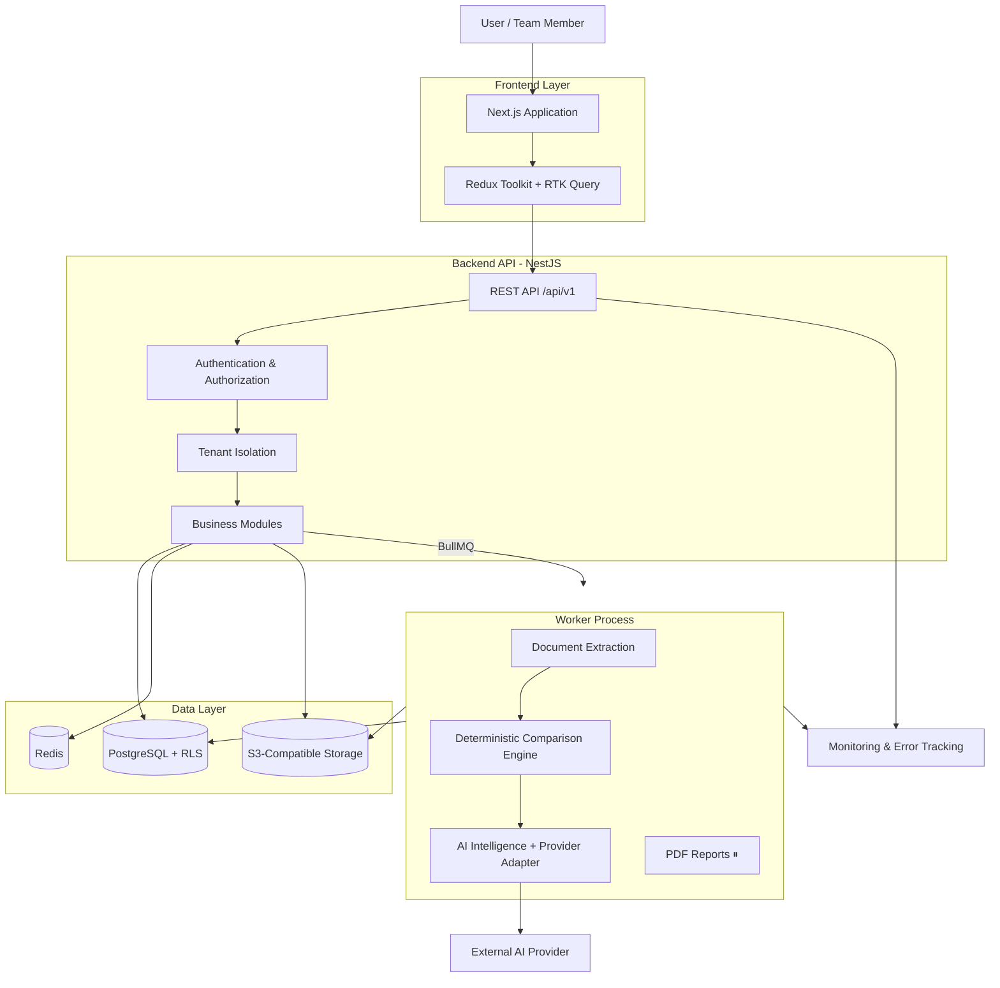
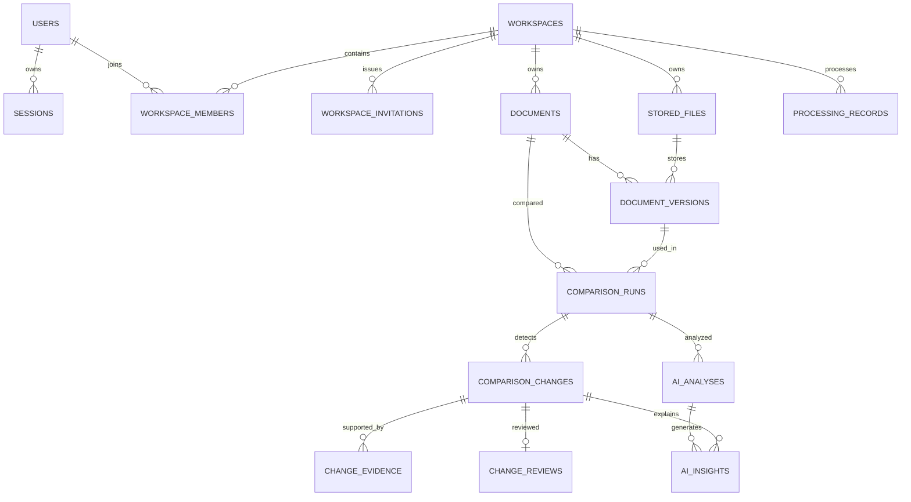

# ChangeRadar Backend — ARCHITECTURE.md

**Product:** ChangeRadar — AI-Powered Document Change Intelligence Platform
**Application:** Backend API + Background Worker (one repository, two runtime processes)
**Architecture:** Modular Monolith + Separate Worker Process
**Version:** 2.1 — Full Architecture with MVP Scope (development-ready)
**Last updated:** 2026-11-27
**Status:** Ready for development (v2.1 readiness review applied)
**Companion files:** `backend/TASKS.md`, `frontend/ARCHITECTURE.md`, `frontend/TASKS.md`

> This file merges and replaces `CHANGERADAR_SYSTEM_ARCHITECTURE.md`, `CHANGERADAR_BACKEND_ARCHITECTURE.md` and `CHANGERADAR_DATABASE_ARCHITECTURE.md`.
>
> **How to read it:** every architecture decision from v1 is kept. Parts A–E describe the complete design and what is built in the **MVP**. Everything that is designed but **not built in the MVP** is marked **⏸ Deferred** where it appears and is fully specified in **Part F — Future Scope** at the end, so it can be added later without restructuring the system.

---

## Changes in v2.1 (readiness review)

No v2.0 decision was reversed. v2.1 closes gaps found before development started:

| § | Change |
|---|---|
| 9.1 | CSRF bootstrap (`GET /auth/csrf`, no exemptions); cookie table; `cr_access` cookie now outlives the JWT so `TOKEN_EXPIRED` is observable |
| 9.2 | Machine-readable permission keys; `GET /workspaces/:ws` returns `myRole` and `permissions` |
| 11 | Upload completion is idempotent by token `jti` (checked first); duplicate rule clarified; presign host and bucket CORS |
| 14 / 30 | Comparison `summary` includes review counts; changes are addressable by index (single-change endpoint with `indexInFilter`) |
| 15 | AI analyzes up to `AI_MAX_CHANGES` changes; coverage exposed to clients |
| 17 / 18 | New settings (`S3_PUBLIC_ENDPOINT`, `AI_MAX_CHANGES`, `TRUST_PROXY_HOPS`, demo limits); client IP behind the frontend rewrite; demo protection |
| 24 | Additive columns: `document_versions.upload_token_id`, `ai_analyses.analyzed_change_count` |
| 30 | New endpoints/rows (`/auth/csrf`, single change); dashboard returns counts only; new §30.3 response shapes |
| 31 / 33 | Decisions M-10 … M-17; deferred item 33.30 |
| 5 / 11.2 / 20–21 | Local object storage is **RustFS** (Apache 2.0). MinIO community images and binaries are no longer publicly distributed (Docker Hub repositories removed; `dl.min.io` returns 410). The S3 adapter, `S3_*` settings, presigned-URL contract and private-bucket rules are unchanged. |

---

## Table of Contents

**Part A — Overview**
1. Purpose and Product
2. MVP Scope and Milestones
3. Architecture Principles
4. System Overview
5. Technology Stack

**Part B — Backend Design**
6. Modules
7. Folder Structure
8. Multi-Tenant Isolation
9. Authentication and Authorization
10. API Conventions
11. Document Upload and Storage
12. Background Processing
13. Document Extraction
14. Deterministic Comparison Engine
15. AI Intelligence
16. Real-Time Status Updates
17. Caching, Configuration and Secrets
18. Security and Privacy
19. Observability
20. Testing Strategy
21. Infrastructure and Deployment

**Part C — Database**
22. Conventions
23. Enums
24. MVP Tables
25. Composite Foreign Keys
26. Delete Behaviour
27. RLS Classification
28. Indexes
29. Migrations, Seeds, Pooling and Backups

**Part D — API Contract**
30. Endpoints and Error Codes

**Part E — Decision Log**
31. Resolved Decisions

**Part F — Future Scope (⏸ Deferred, not built in the MVP)**
32. Rules for Adding Deferred Features
33. Deferred Features
34. Deferred Table Specifications

---

# PART A — OVERVIEW

# 1. Purpose and Product

ChangeRadar compares versions of a document (contracts, policies, specifications) and answers two questions:

1. **What changed?** — a **deterministic comparison engine**. Same input and engine version always give the same output. Works without AI.
2. **Why does it matter?** — an **AI intelligence layer** that explains changes, using deterministic results as evidence.

These two layers are always separate. The deterministic engine must work when AI is disabled, unavailable or failing.

---

# 2. MVP Scope and Milestones

## 2.1 Scope

The MVP is a smaller, finished, deployable version of the full design. It uses the **same architecture, same modules, same database design and same security model**. Only some modules and features are deferred.

| Area | MVP (built now) | ⏸ Deferred (Part F) |
|---|---|---|
| Authentication | Email + password, access/refresh tokens in HttpOnly cookies, refresh rotation, logout, session list and revocation, password change, CSRF, rate limits | Google OAuth, email verification, forgot/reset password, refresh-token reuse detection |
| Workspaces | Create, update, switch, roles OWNER / ADMIN / MEMBER / VIEWER, member list, role change, member removal | Ownership transfer, workspace deletion lifecycle |
| Invitations | Invitation **link** for an email address, expiry, usage limit, revocation, acceptance | Sending invitation emails |
| Documents | Create, update, archive, soft delete, immutable versions, presigned upload, verification, checksum duplicate check, secure download, title filter | Folders, tags/categories, hard deletion and retention, full-text search |
| Formats | Text-based PDF, DOCX, TXT, Markdown | OCR / scanned PDF |
| Extraction | Async extraction with structure (headings, paragraphs, lists, basic tables, pages) | — |
| Comparison | ADDED, REMOVED, MODIFIED, STRUCTURAL changes; evidence; deterministic severity; history; rerun | SEMANTIC and FORMATTING detection, cancellation |
| Review | Reviewed / Needs Attention / Ignored with note and reviewer | Full review history table |
| AI | One provider behind adapter, summary + explanation + impact + contextual severity, evidence validation, history, AI-only rerun, workspace AI toggle | Additional providers |
| Status | Persisted status + frontend polling (the SSE fallback path) | SSE live updates, notifications |
| Reports | — | PDF reports |
| Search | Title filter on document list | PostgreSQL Full-Text + Trigram search |
| Activity / Audit | — | Activity timeline, security audit logs |
| Billing | Simple AI daily safety limit (configuration) | Plans, subscriptions, usage ledger, quotas |
| Data lifecycle | Soft delete | Export, workspace deletion, retention, object purge |
| Portfolio | "Try demo" mode (isolated module) | — |

## 2.2 Milestones

Each milestone ends with a **deployed, working application**. If work stops after any milestone, a complete product still exists.

| Milestone | Contents | Result |
|---|---|---|
| **M0 — Skeleton** | Repository, core infrastructure, empty app deployed to staging | Deployment pipeline proven on day one |
| **M1 — Core** | Database + RLS, auth, workspaces, documents, extraction, comparison engine | Upload two versions and see a deterministic comparison |
| **M2 — Intelligence** | Review workflow, AI analysis | The full product idea works |
| **M3 — Portfolio release** | Invitations, dashboard, demo mode, hardening, README | Public portfolio release |
| **Post-MVP** | Part F features, in any order | Full SaaS roadmap |

---

# 3. Architecture Principles

1. Modular and maintainable design.
2. Clear ownership boundaries.
3. Multi-tenant security by design.
4. Defense-in-depth security.
5. Deterministic processing wherever possible.
6. Evidence-grounded AI intelligence.
7. Asynchronous processing for expensive operations.
8. Privacy-first data handling.
9. Provider-agnostic external integrations.
10. Testability and observability.
11. Controlled scalability.
12. Avoid unnecessary infrastructure complexity.
13. **(MVP rule)** Defer features by leaving modules out, never by changing the shape of the core design.

---

# 4. System Overview



| Component | Responsibility |
|---|---|
| Next.js | User interface, routing, rendering; polls processing status |
| Redux Toolkit / RTK Query | Client state / server state and API communication |
| NestJS API | Business logic and API endpoints |
| Authorization | Authentication, RBAC, resource ownership |
| Tenant Isolation | Workspace-level isolation (application + Prisma + RLS) |
| PostgreSQL | Source of truth for all business data and processing status |
| Redis | BullMQ queues, cache, distributed rate limiting |
| Worker | Extraction, comparison, AI analysis, maintenance (reports ⏸) |
| Object Storage | Original files (generated reports ⏸) |
| AI Adapter | Provider-independent AI integration |
| Monitoring | Logs, errors, health |

**Deployment topology:** same-origin. The frontend forwards `/api/*` to the backend, so authentication cookies are first-party and CORS is not required. Cross-origin deployment remains possible with explicit CORS and credential configuration.

---

# 5. Technology Stack

| Category | Technology |
|---|---|
| Framework | NestJS + TypeScript (strict) |
| Database | PostgreSQL (16+) |
| ORM | Prisma + manual SQL migrations |
| Tenant isolation | Application authorization + Prisma scoping + PostgreSQL RLS |
| Queue | BullMQ + Redis |
| Cache / rate limit store | Redis |
| API | Versioned REST + JSON, `/api/v1` |
| API documentation | OpenAPI / Swagger |
| Validation | class-validator + class-transformer (DTOs); Zod for job payloads and AI output |
| Authentication | Backend-managed, HttpOnly cookies, access + refresh tokens, argon2id |
| Storage | S3-compatible (AWS SDK v3); RustFS locally |
| Extraction | `pdfjs-dist`, `mammoth`, `remark`, plain text reader |
| Diff | `diff` (jsdiff) |
| Logging | `nestjs-pino` structured JSON |
| Rate limiting | `@nestjs/throttler` + Redis storage |
| Real-time | Polling (MVP); SSE ⏸ |
| Testing | Jest or Vitest, Supertest, Testcontainers |
| Containers | Docker + Docker Compose |
| CI/CD | GitHub Actions |

Exact versions are confirmed and pinned in Phase 0.

---

# PART B — BACKEND DESIGN

# 6. Modules

| Module | Responsibility | MVP |
|---|---|---|
| Auth | Registration, login, sessions, refresh rotation, revocation | ✓ (OAuth, verification, reset ⏸) |
| Users | Profile, password change | ✓ |
| Workspaces | Workspace and membership | ✓ (deletion, ownership transfer ⏸) |
| Invitations | Invitation links, expiry, revocation, acceptance | ✓ (email sending ⏸) |
| Authorization | RBAC guards, permission policies, resource ownership | ✓ |
| Documents | Document identity, metadata, lifecycle | ✓ |
| Versions | Immutable versions | ✓ |
| Storage | Object storage adapter, upload verification, downloads | ✓ |
| Extraction | Parsing, normalization, structure | ✓ |
| Comparisons | Deterministic engine, runs, history | ✓ |
| Reviews | Review status | ✓ |
| AI Intelligence | Adapter, analysis, insights | ✓ |
| Processing | `processing_records` status tracking | ✓ |
| Dashboard | Aggregated workspace overview | ✓ |
| Demo | Portfolio demo accounts (isolated, removable) | ✓ |
| Health | Health and readiness | ✓ |
| Reports | PDF reports | ⏸ |
| Notifications | Persistent notifications + SSE | ⏸ |
| Activity | Activity timeline | ⏸ |
| Audit Logs | Security audit records | ⏸ |
| Usage & Quotas | Usage ledger and quota enforcement | ⏸ |
| Billing | Plans and subscriptions | ⏸ |
| Search | Full-text and trigram search | ⏸ |
| Analytics | Privacy-first analytics | ⏸ |
| Support | Feedback and support | ⏸ |
| Feature Flags | Feature availability | ⏸ |

**Module rules (unchanged from v1)**

- Each module owns its business rules, its tables and its data-access logic.
- Modules communicate through exported services (direct service-to-service communication). No access to another module's private repositories.
- No circular dependencies (checked with `madge` in CI).
- Long-running work goes through BullMQ.
- Shared infrastructure contains no business logic.
- Tenant-aware operations always carry workspace context.

---

# 7. Folder Structure

```text
src/
├── main.ts                       # API entry
├── worker.ts                     # Worker entry (no HTTP server)
├── app.module.ts
├── worker.module.ts
├── config/                       # env schema + typed config
├── common/
│   ├── errors/                   # AppException, error codes, global filter
│   ├── guards/                   # AuthGuard, WorkspaceGuard, PermissionGuard
│   ├── decorators/               # @CurrentUser, @CurrentWorkspace, @RequirePermission, @Public
│   ├── interceptors/             # response envelope, correlation id
│   └── pagination/
├── infrastructure/
│   ├── database/                 # PrismaService, TenantDb
│   ├── storage/                  # StorageService (S3 adapter)
│   ├── queue/                    # queue names, Zod payloads, producers
│   └── redis/
└── modules/
    ├── auth/
    ├── users/
    ├── workspaces/
    ├── invitations/
    ├── authorization/            # permission matrix, policies
    ├── documents/
    ├── versions/
    ├── storage/                  # upload/download use cases
    ├── extraction/
    ├── comparisons/
    │   └── engine/               # pure TypeScript, no NestJS/Prisma/I/O
    ├── reviews/
    ├── ai-intelligence/
    │   └── providers/            # FakeAiProvider + one real adapter
    ├── processing/
    ├── dashboard/
    ├── demo/
    └── health/
prisma/
├── schema.prisma
├── migrations/                   # Prisma migrations + manual SQL migrations
└── seed.ts
test/
├── e2e/
├── isolation/                    # cross-tenant suite
└── fixtures/documents/           # sample document pairs
```

Deferred modules (`reports`, `notifications`, `activity`, `audit-logs`, `usage`, `billing`, `search`, …) are added as new folders under `modules/` later.

---

# 8. Multi-Tenant Isolation

**Decision: Hybrid Multi-Tenant Isolation — NestJS + Prisma + PostgreSQL RLS.** A Workspace is a Tenant.

## 8.1 Three layers

| Layer | Mechanism |
|---|---|
| 1. Application authorization | `AuthGuard` → `WorkspaceGuard` (membership from URL `:workspaceId`) → `PermissionGuard` (role) → resource ownership checks in services |
| 2. Prisma workspace scoping | Every tenant query filters by `workspaceId`; client-supplied IDs are never trusted |
| 3. PostgreSQL RLS | Policies compare `workspace_id` with a transaction-local setting; `FORCE ROW LEVEL SECURITY` |

No layer replaces another.

## 8.2 Tenant context

Transaction-local settings:

| Setting | Purpose |
|---|---|
| `app.current_workspace_id` | Active workspace |
| `app.current_user_id` | Authenticated user (lets a user list their own memberships) |
| `app.invitation_token_hash` | Lets an invitee read exactly one invitation by token hash before they are a member |

Helper functions (manual SQL):

```sql
CREATE FUNCTION app_current_workspace_id() RETURNS uuid LANGUAGE sql STABLE AS
$$ SELECT NULLIF(current_setting('app.current_workspace_id', true), '')::uuid $$;

CREATE FUNCTION app_current_user_id() RETURNS uuid LANGUAGE sql STABLE AS
$$ SELECT NULLIF(current_setting('app.current_user_id', true), '')::uuid $$;

CREATE FUNCTION app_invitation_token_hash() RETURNS text LANGUAGE sql STABLE AS
$$ SELECT NULLIF(current_setting('app.invitation_token_hash', true), '') $$;
```

Missing context returns `NULL`, `workspace_id = NULL` is never true, so **missing context fails closed**.

## 8.3 `TenantDb` — the only access path to tenant tables

```typescript
run<T>(ctx: TenantContext, fn: (tx: Prisma.TransactionClient) => Promise<T>): Promise<T> {
  return this.prisma.$transaction(async (tx) => {
    await tx.$executeRaw`SELECT set_config('app.current_workspace_id', ${ctx.workspaceId ?? ''}, true)`;
    await tx.$executeRaw`SELECT set_config('app.current_user_id', ${ctx.userId ?? ''}, true)`;
    if (ctx.invitationTokenHash) {
      await tx.$executeRaw`SELECT set_config('app.invitation_token_hash', ${ctx.invitationTokenHash}, true)`;
    }
    return fn(tx);
  }, { timeout: 10_000 });
}
```

Rules:

- The third `set_config` argument `true` = transaction-local (`SET LOCAL` equivalent). It ends at commit/rollback, so pooled connections cannot leak context.
- All protected queries inside `fn` use `tx`.
- Session-level `SET` and `$queryRawUnsafe` are forbidden (CI check).
- No external calls (storage downloads, AI requests) inside a tenant transaction.

## 8.4 Database roles

| Role | Used by | Privileges |
|---|---|---|
| `changeradar_migrator` | Prisma Migrate (`directUrl`) | Owns tables; DDL |
| `changeradar_app` | API + Worker (`url`) | `NOSUPERUSER NOBYPASSRLS`; DML only; column-level UPDATE grants on immutable tables |

Cross-tenant administrative operations are explicit, restricted and run per workspace with tenant context (no `BYPASSRLS` role exists in the MVP).

## 8.5 Request flow

```text
Request /api/v1/workspaces/:workspaceId/...
  → AuthGuard           access cookie → session not revoked → user
  → WorkspaceGuard      TenantDb(user ctx) → membership → 404 WORKSPACE_NOT_FOUND if none
  → PermissionGuard     role has permission?
  → Service             TenantDb.run({ userId, workspaceId }) → Prisma query with workspaceId → RLS
```

Non-members receive 404 (not 403) so workspace IDs cannot be probed.

## 8.6 Worker isolation

- Every job payload carries `workspaceId` and a resource ID; payloads are not trusted as authorization.
- The Worker opens `TenantDb.run({ workspaceId })` and loads the resource; if it is not visible, the job fails permanently.
- Retries never reuse context from a previous attempt.

---

# 9. Authentication and Authorization

## 9.1 Authentication (decision: backend-managed, secure HttpOnly cookies)

| Item | Design |
|---|---|
| Password hashing | argon2id; never stored or logged in plaintext |
| Access token | Signed JWT (15 min, `ACCESS_TOKEN_TTL_MINUTES`) with `sub` (user) and `sid` (session); cookie `cr_access`, `Path=/`. **The cookie outlives the JWT** (see the cookie table below). A JWT that is expired but has a valid signature → `401 TOKEN_EXPIRED` (the client refreshes); a missing cookie or invalid signature → `401 UNAUTHENTICATED`. |
| Refresh token | Random 32 bytes; cookie `cr_refresh`, `Path=/api/v1/auth`; only its SHA-256 is stored in `sessions.refresh_token_hash` |
| Cookie attributes | `HttpOnly`, `Secure` (production), `SameSite=Lax` |
| Refresh rotation | `POST /auth/refresh` atomically replaces the hash (`UPDATE … WHERE refresh_token_hash = $old AND revoked_at IS NULL AND expires_at > now() RETURNING`). The old token stops working immediately. |
| Session lifetime | 30 days absolute (`expires_at`) |
| Revocation | `AuthGuard` checks the `sid` session is not revoked on each request (primary-key lookup), so logout and revocation are immediate |
| Logout | Revokes the current session, clears cookies |
| Session management | List own sessions, revoke one, revoke all others |
| Password change | Requires current password; revokes all other sessions |
| CSRF | Double-submit: non-HttpOnly cookie `cr_csrf` + `X-CSRF-Token` header on every non-GET request, **no exemptions**; bootstrapped by `GET /auth/csrf` (see below) |
| Rate limits | Login, register, refresh, demo (see §18) |

**Cookie and CSRF rules (v2.1)**

| Cookie | HttpOnly | Path | Max-Age | Set / cleared by |
|---|---|---|---|---|
| `cr_access` | yes | `/` | remaining session lifetime (≤ 30 days) | Set by register, login, demo, refresh. Cleared by logout and by any `INVALID_REFRESH_TOKEN` / `SESSION_REVOKED` response |
| `cr_refresh` | yes | `/api/v1/auth` | remaining session lifetime | Same as `cr_access` |
| `cr_csrf` | **no** | `/` | 30 days | `GET /auth/csrf`; rotated by register, login, demo, refresh |

- `cr_csrf` value: 32 random bytes, base64url, not tied to a session. `CsrfGuard` answers `403 CSRF_INVALID` unless the `X-CSRF-Token` header equals the cookie (constant-time comparison).
- **Every request that is not GET, HEAD or OPTIONS needs the header — including `login`, `register`, `refresh` and `demo`.** When the cookie is absent the client first calls `GET /auth/csrf`: it is `@Public`, sets the cookie if missing and returns `{ "csrfToken": "…" }` (same value).
- All cookies: `SameSite=Lax`, `Secure` in production, no `Domain` attribute (first-party, same origin through the frontend rewrite). Clearing a cookie = same name and `Path` with `Max-Age=0`.
- The frontend's route protection sees only `cr_access` (the refresh cookie's path hides it from page requests). Because `cr_access` outlives the JWT, a user whose JWT expired still reaches the page and is refreshed by the first API call.
- Presigned storage requests are cross-origin and carry no cookies or CSRF header.

⏸ Deferred: Google OAuth (`auth_accounts`), email verification and password reset (`verification_tokens`), refresh-token reuse detection (token family table). See Part F.

## 9.2 Authorization (decision: RBAC + resource ownership + RLS)

Permission matrix (`authorization` module):

| Permission | OWNER | ADMIN | MEMBER | VIEWER |
|---|---|---|---|---|
| Read workspace data | ✓ | ✓ | ✓ | ✓ |
| Create/edit/archive documents, upload versions | ✓ | ✓ | ✓ | |
| Soft-delete documents | ✓ | ✓ | own documents | |
| Create comparisons, run AI analysis | ✓ | ✓ | ✓ | |
| Update review status | ✓ | ✓ | ✓ | |
| Update workspace name/settings (incl. AI toggle) | ✓ | ✓ | | |
| Create/revoke invitations (role ≤ ADMIN) | ✓ | ✓ | | |
| Change member roles / remove members | ✓ | ✓ (not OWNER rows) | | |
| Leave workspace | ✓ (not last OWNER) | ✓ | ✓ | ✓ |
| Delete workspace, transfer ownership | ⏸ | | | |

**Permission keys (v2.1).** Machine-readable names used by `@RequirePermission()`, returned to the frontend and used in tests. Each matrix row above maps to one key:

| Key | Matrix row | Roles |
|---|---|---|
| `workspace:read` | Read workspace data | OWNER, ADMIN, MEMBER, VIEWER |
| `document:write` | Create/edit/archive documents, upload versions | OWNER, ADMIN, MEMBER |
| `document:delete` | Soft-delete any document | OWNER, ADMIN |
| `document:delete:own` | Soft-delete own documents (`documents.created_by` = caller) | MEMBER |
| `comparison:create` | Create comparisons | OWNER, ADMIN, MEMBER |
| `ai:run` | Run AI analysis | OWNER, ADMIN, MEMBER |
| `review:update` | Update review status | OWNER, ADMIN, MEMBER |
| `workspace:update` | Update workspace name/settings (incl. AI toggle) | OWNER, ADMIN |
| `invitation:manage` | Create / list / revoke invitations (role ≤ ADMIN) | OWNER, ADMIN |
| `member:manage` | Change member roles / remove members | OWNER, ADMIN (never OWNER rows) |
| `workspace:leave` | Leave workspace | all (not the last OWNER) |

`GET /workspaces/:ws` returns `myRole` and `permissions` (the caller's keys). The frontend uses the list for UX only and never re-implements the matrix.

A workspace always keeps at least one OWNER (checked inside a transaction with `SELECT … FOR UPDATE` on owner rows). OWNER is never granted through invitations.

Frontend route protection is only UX; backend authorization and RLS are authoritative.

---

# 10. API Conventions

## 10.1 Format

- Versioned REST + JSON, prefix `/api/v1`, HTTPS in production.
- OpenAPI at `/api/docs` (toggled by `SWAGGER_ENABLED`).
- Global `ValidationPipe({ whitelist: true, forbidNonWhitelisted: true, transform: true })`. Frontend Zod validation is UX only.

## 10.2 Responses

Success:

```json
{ "success": true, "data": {}, "meta": { "page": 1, "pageSize": 20, "total": 57 } }
```

`meta` only on paginated lists (`?page=1&pageSize=20`, max 100).

Error (v1 contract + `details` and `correlationId`):

```json
{
  "success": false,
  "statusCode": 422,
  "errorCode": "VALIDATION_ERROR",
  "message": "The request contains invalid data.",
  "details": [{ "field": "title", "message": "title should not be empty" }],
  "correlationId": "01JD…",
  "timestamp": "2026-11-27T00:00:00.000Z",
  "path": "/api/v1/workspaces/…/documents"
}
```

No stack traces in production responses.

## 10.3 Error handling

Global exception filter + module domain exceptions (`AppException` with `errorCode`). Prisma errors are mapped (unique violation → 409, FK/RLS violation → 404/403 as appropriate). The full catalog is in §30.2.

## 10.4 Rate limiting

NestJS Throttler with Redis storage; IP and user limits; HTTP 429. Request-rate limits are separate from usage quotas (⏸).

---

# 11. Document Upload and Storage

## 11.1 Flow (v1 flow, unchanged)

```text
1. POST …/documents/:documentId/versions/upload-url  { filename, mimeType, size }
   → auth + permission + document ACTIVE
   → extension/size validation, AI/quota checks n/a
   → tempKey = uploads/{workspaceId}/{uuid}
   → return { uploadUrl (presigned PUT, 10 min, fixed Content-Type/Length), uploadToken }

2. Browser PUTs the file directly to object storage.

3. POST …/documents/:documentId/versions  { uploadToken }
   → verify token (HMAC, expiry, user, workspace, document)
   → IDEMPOTENCY FIRST: SELECT version WHERE workspace_id AND upload_token_id = token.jti
        found → return it (same response as the first success); nothing else runs
   → HEAD tempKey: exists, size == declared, ≤ limit (else 400 UPLOAD_NOT_FOUND / FILE_TOO_LARGE)
   → stream object: SHA-256 checksum + file signature check (%PDF, DOCX zip, UTF-8 text)
   → duplicate check: same checksum as the latest version whose processing_status ≠ FAILED → 409 DUPLICATE_VERSION
   → CopyObject → documents/{workspaceId}/{documentId}/{storedFileId}.{ext}; delete tempKey
   → transaction: insert stored_files (AVAILABLE), lock document row, version_number = max + 1,
     insert document_versions (PENDING, upload_token_id = jti), insert processing_records (QUEUED)
        unique violation on (workspace_id, upload_token_id) → a parallel request with the same token won:
        best-effort delete of the object just copied, return the existing version
   → enqueue extraction job (after commit)
   → return version
```

- `uploadToken` = HMAC-signed `{ jti (random UUID), workspaceId, documentId, userId, tempKey, mimeType, size, exp }`. Clients cannot choose storage keys.
- Completing the same token twice returns the existing version. The lookup uses `document_versions.upload_token_id` and runs **before** any storage call, so it still works after `tempKey` was deleted and never produces `DUPLICATE_VERSION`.
- Uploading the same file again with a **new** token is a duplicate (409) unless the latest version failed extraction (then it is accepted as a new version).
- Abandoned uploads under `uploads/` are removed by a bucket lifecycle rule (1 day).

## 11.2 Rules

- Private bucket; never public objects.
- Presigned URLs are signed for `S3_PUBLIC_ENDPOINT` (the address the **browser** reaches, e.g. `http://localhost:9000` for local RustFS); server-side calls use `S3_ENDPOINT`.
- Bucket CORS (local compose init script and production): allow `PUT` and `GET` from the frontend origin (`APP_URL`), header `Content-Type`, expose `ETag`.
- Downloads: `GET …/download-url` → presigned GET, 5 minutes, `Content-Disposition: attachment`.
- Never trust client MIME type or size; never log presigned URLs or tokens.
- Equal checksums in different workspaces are never shared (DB-14).
- ⏸ Malware scanning/quarantine, hard deletion and object purge: Part F.

## 11.3 Limits (configurable)

| Limit | Default |
|---|---|
| Max file size | 10 MB |
| Max PDF pages | 200 |
| Max blocks per version | 5,000 |
| Max extracted characters | 1,000,000 |

---

# 12. Background Processing

## 12.1 Queues

| Queue | Job ID (= `processing_records.job_id`) | Payload |
|---|---|---|
| `document-extraction` | `extraction:{versionId}` | `{ workspaceId, versionId, processingRecordId }` |
| `comparison` | `comparison:{runId}` | `{ workspaceId, comparisonRunId, processingRecordId }` |
| `ai-analysis` | `ai-analysis:{analysisId}` | `{ workspaceId, aiAnalysisId, processingRecordId }` |
| `maintenance` | `maintenance:{task}:{date}` | demo cleanup, expired sessions |
| `report-generation` ⏸ | `report:{reportId}` | Part F |

Payloads are Zod-validated. Deterministic job IDs make double-enqueue harmless (BullMQ ignores duplicates; `job_id` is UNIQUE in PostgreSQL).

## 12.2 Durable status

BullMQ executes jobs; **PostgreSQL is the source of business status** (v1 decision). `processing_records` tracks every job, and the resource's own status column (`document_versions.processing_status`, `comparison_runs.status`, `ai_analyses.status`) is updated in the same transaction.

## 12.3 Processor pattern

```text
Tx 1 (tenant ctx): load processing record + resource; if terminal → return (idempotent)
                   attempt_count += 1, status PROCESSING, started_at
Outside Tx:        download / extract / compare / call AI
Tx 2 (tenant ctx): insert results + resource status COMPLETED + record COMPLETED (one transaction)
Final failure:     Tx: resource FAILED + record FAILED + error_code
```

Results and status are committed together, so crashes and retries cannot leave partial results.

## 12.4 Reliability settings

- `max_attempts` 3, exponential backoff from 5 s.
- Permanent errors use `UnrecoverableError` (e.g. `NO_TEXT_LAYER`, `TOO_MANY_CHANGES`).
- Concurrency per queue from environment variables.
- Graceful shutdown on `SIGTERM`.
- Job correlation IDs in logs.
- ⏸ Per-attempt history table (`processing_attempts`), job cancellation: Part F.

---

# 13. Document Extraction

| Format | Library | Structure kept |
|---|---|---|
| TXT | built-in | Paragraphs (blank-line separated) |
| Markdown | `remark` (mdast) | Headings, paragraphs, list items, table rows — stored as text, never rendered as HTML |
| DOCX | `mammoth` | Headings (by style), paragraphs, lists, table rows |
| PDF (text-based) | `pdfjs-dist` | Paragraphs, page numbers; scanned PDFs fail with `NO_TEXT_LAYER` |

**Storage (DB-05):** in `document_versions`:

- `extracted_text` — full normalized text; blocks are separated by `\n\n`, so evidence offsets (`start_offset`, `end_offset`) point into this text.
- `extraction_metadata` — `{ extractorVersion, pageCount, blockCount, charCount, blocks: Block[] }`.

```json
{
  "id": "b0007",
  "type": "heading | paragraph | list_item | table_row",
  "level": 2,
  "text": "Payment shall be made within 30 days.",
  "sectionPath": ["4. Payment Terms"],
  "page": 3,
  "startOffset": 1840,
  "endOffset": 1877,
  "hash": "sha256 of normalized text"
}
```

Normalization: Unicode NFC, whitespace collapse, quote/dash normalization, trim. List queries never select `extracted_text` or `extraction_metadata`.

---

# 14. Deterministic Comparison Engine

## 14.1 Contract

```typescript
compare(source: Block[], target: Block[], options: CompareOptions): EngineResult
```

Pure function in `comparisons/engine/`. No randomness, clock or I/O. Stable ordering. `ENGINE_VERSION` constant (e.g. `1.0.0`) stored in `comparison_runs.engine_version`.

## 14.2 Algorithm

1. Normalize blocks per options (`ignoreWhitespace`, `ignoreCase`) and hash.
2. Align hash sequences (LCS/Myers array diff) → equal / removed / added.
3. Removed + added blocks with identical hash → **STRUCTURAL** (moved).
4. Same text but changed block type or heading level → **STRUCTURAL**.
5. Remaining removed/added blocks in the same region paired by word similarity ≥ 0.6 → **MODIFIED** with word-level inline diff.
6. Unpaired → **REMOVED** / **ADDED**.
7. Signals and deterministic severity (§14.3).
8. Evidence records for the source and/or target side (§14.4).
9. Fingerprint = SHA-256(category + old hash + new hash).

More than 5,000 changes → run fails with `TOO_MANY_CHANGES`.

⏸ SEMANTIC and FORMATTING categories exist in the enum but are not emitted by engine v1 (Part F).

## 14.3 Signals and severity

Stored in `comparison_changes.metadata`:

```json
{ "signals": ["MONEY_CHANGED"], "inlineDiff": [{ "op": "equal|insert|delete", "text": "…" }], "blockType": "paragraph", "structuralKind": "MOVED|TYPE_CHANGED" }
```

| Signal | Detected when |
|---|---|
| `NUMBER_CHANGED` | A number differs |
| `MONEY_CHANGED` | A currency amount differs |
| `DATE_CHANGED` | A date or duration differs |
| `OBLIGATION_CHANGED` | may / must / shall / should / will changes |
| `NEGATION_CHANGED` | not / no / never added or removed |
| `HEADING_CHANGED` | The block is a heading |

| Severity | Rule |
|---|---|
| HIGH | MODIFIED with money, date, number, obligation or negation signal; REMOVED block containing an obligation word |
| MEDIUM | Other ADDED / REMOVED / MODIFIED; heading changes |
| LOW | STRUCTURAL; punctuation/case-only modifications |
| CRITICAL | Never assigned deterministically — reserved for AI contextual severity |

## 14.4 Evidence

Each change has 1–2 `change_evidence` rows:

| Field | Value |
|---|---|
| `evidence_type` | `SOURCE_BLOCK` (old side) or `TARGET_BLOCK` (new side) |
| `source_version_id` | Run's source version or target version (service-validated) |
| `page_number`, `section_path` | From the block |
| `start_offset`, `end_offset` | Offsets in that version's `extracted_text` |
| `excerpt` | Block text (max 2,000 chars) |

`old_location` / `new_location` on the change hold `{ blockId, blockIndex, sectionPath, page }` for fast UI navigation.

## 14.5 Runs and history

- Version pair rules: same document, same workspace, different versions, both `COMPLETED` extraction.
- Reruns always create new runs. Results are never overwritten. Failed runs remain visible.
- Fixture snapshot tests detect any behaviour change; behaviour changes require an `ENGINE_VERSION` bump.

---

# 15. AI Intelligence

## 15.1 Adapter (decision: provider-agnostic, one provider for MVP)

```typescript
interface AiProvider {
  readonly name: string;
  analyze(input: AiAnalysisInput, signal: AbortSignal): Promise<AiProviderResult>;
}
```

- `FakeAiProvider`: deterministic output for tests, CI and running without an API key.
- One real provider adapter selected by `AI_PROVIDER` / `AI_MODEL`. SDK code stays inside the adapter.

## 15.2 Flow

```text
POST …/comparisons/:runId/ai-analyses
  → permission, workspace settings.aiEnabled, run COMPLETED, daily safety limits
  → insert ai_analyses (QUEUED) + processing_records → enqueue
Worker:
  → eligibility & privacy check (aiEnabled still true)
  → context: up to `AI_MAX_CHANGES` (default 50) changes chosen by severity (HIGH, then MEDIUM, then LOW), ties by `sequence_number` ascending; texts truncated to 1,500 chars, section paths — never full documents; the number chosen is stored in `ai_analyses.analyzed_change_count`
  → provider call (60 s timeout) → Zod validation (one retry on invalid output)
  → evidence validation: references must be change/evidence IDs of this run, otherwise the insight is dropped
  → insert insights + COMPLETED (one transaction), token counts and estimated cost recorded
```

## 15.3 Output schema

```json
{
  "summary": { "title": "string", "content": "string" },
  "insights": [{
    "changeId": "uuid",
    "type": "EXPLANATION | BUSINESS_IMPACT | RISK | RECOMMENDATION",
    "title": "string",
    "content": "string",
    "severity": "CRITICAL | HIGH | MEDIUM | LOW",
    "confidence": 0.0,
    "isUncertain": false,
    "evidence": { "changeIds": ["uuid"], "evidenceIds": ["uuid"] }
  }]
}
```

## 15.4 Rules (v1)

- AI never changes deterministic comparison data.
- AI-only reruns create new analyses; history is preserved.
- Verified facts and potential impact are distinguished (`BUSINESS_IMPACT` / `RISK` are presented as potential).
- Uncertainty is explicit (`is_uncertain`, `confidence_score`).
- Chain-of-thought is never requested or stored; prompts and responses are not logged.
- AI failure never blocks or alters comparison results.
- Changes outside the selected set have no insight. The API exposes `analyzedChangeCount` and `totalChangeCount` so clients can show "Analyzed N of M changes" and "Not analyzed by AI" (§30.3).
- Provider, model and prompt version are recorded.
- Daily safety limits (`AI_DAILY_LIMIT_PER_WORKSPACE`, `AI_GLOBAL_DAILY_LIMIT` via Redis counter) protect cost until the usage/quota module (⏸) replaces them.

---

# 16. Real-Time Status Updates

**Decision (v1): SSE for live updates, PostgreSQL as source of truth, polling as fallback.**

- **MVP:** the fallback path only. The frontend polls resource status endpoints while a job is running. All status is persisted, so nothing changes when SSE is added.
- ⏸ **SSE** (`GET /api/v1/workspaces/:ws/events`) and persistent notifications: Part F.

---

# 17. Caching, Configuration and Secrets

**Caching (Redis):** BullMQ, throttler storage and the global AI counter use separate key prefixes. No application data caching is required in the MVP; PostgreSQL remains the source of truth. Any future cache needs explicit TTL and invalidation rules.

**Configuration:** `ConfigModule` with a validated schema; the app fails fast on invalid configuration. `.env` is never committed; `.env.example` documents every variable.

```text
NODE_ENV, PORT, APP_URL
DATABASE_URL                     # runtime role
DIRECT_DATABASE_URL              # migrator role
REDIS_URL
S3_ENDPOINT, S3_PUBLIC_ENDPOINT, S3_REGION, S3_BUCKET, S3_ACCESS_KEY_ID, S3_SECRET_ACCESS_KEY, S3_FORCE_PATH_STYLE
JWT_ACCESS_SECRET, ACCESS_TOKEN_TTL_MINUTES, SESSION_TTL_DAYS
UPLOAD_TOKEN_SECRET, MAX_UPLOAD_BYTES
AI_PROVIDER, AI_MODEL, AI_API_KEY, AI_MAX_CHANGES
AI_DAILY_LIMIT_PER_WORKSPACE, AI_GLOBAL_DAILY_LIMIT
WORKER_CONCURRENCY_EXTRACTION, WORKER_CONCURRENCY_COMPARISON, WORKER_CONCURRENCY_AI
DEMO_ENABLED, DEMO_RATE_LIMIT_PER_HOUR, DEMO_MAX_ACTIVE, SWAGGER_ENABLED, LOG_LEVEL
TRUST_PROXY_HOPS                 # trusted proxies in front of the API (0 locally)
```

---

# 18. Security and Privacy

| Concern | Measure |
|---|---|
| Defense in depth | Auth → RBAC → ownership → Prisma scoping → RLS → private storage |
| Input | DTO validation, whitelist |
| SQL injection | Prisma parameters; raw SQL only with tagged templates |
| XSS | API returns text only; the frontend never renders document HTML |
| SSRF | The backend never fetches user-supplied URLs; storage endpoint is configuration only |
| Headers | `helmet`; `trust proxy` set from `TRUST_PROXY_HOPS` |
| Rate limits | login 5/min/IP · register 3/min/IP · refresh 30/min/IP · demo `DEMO_RATE_LIMIT_PER_HOUR` (default 10)/hour/IP and at most `DEMO_MAX_ACTIVE` (default 50) live demo workspaces · upload-url 20/min/user · AI 5/min/user |
| Files | Size + signature checks, private bucket, short-lived presigned URLs |
| Logs | Never: document text, extracted text, prompts, passwords, tokens, cookies, presigned URLs. Pino redaction configured. |
| AI privacy | Workspace `aiEnabled` toggle; minimal context; provider/model recorded |
| Dependencies | `npm audit` in CI |

**Client IP behind the frontend rewrite (v2.1).** In production a request travels visitor → hosting edge → Next.js rewrite → API. Per-IP limits only work if the API resolves the **visitor's** IP, not the frontend host's. `TRUST_PROXY_HOPS` is the number of trusted proxies in front of the API (set per environment, `0` locally). Phase 12 verifies on staging that the IP the API logs for a request equals the visitor's IP. If the platform cannot forward it, per-user limits and the demo cap (`DEMO_MAX_ACTIVE`) remain the abuse and cost guard.

⏸ Malware scanning, audit logging, data export, retention enforcement: Part F.

---

# 19. Observability

- Structured JSON logs with request correlation ID (`X-Request-Id` or generated) and job correlation ID.
- `/health` (liveness) and `/health/ready` (PostgreSQL, Redis, storage).
- Error tracking for API and Worker (provider chosen at deployment).
- Job metrics in logs: queue, duration, outcome, attempts.
- ⏸ Metrics dashboards, alerting, OpenTelemetry.

---

# 20. Testing Strategy

| Layer | Focus |
|---|---|
| Unit | Engine, signals, severity, extractors, upload token, permission matrix |
| Engine fixtures | Real document pairs → snapshot of changes and evidence |
| Integration | Services with real PostgreSQL, Redis and S3-compatible storage (RustFS via Testcontainers) |
| API / E2E | HTTP flows with cookies, CSRF, refresh |
| AI | Fake provider: invalid output, timeout, evidence validation |
| Tenant isolation | Mandatory suite below |
| Performance | Engine with 5,000 blocks per side < 5 s |

**Tenant isolation suite (from v1 §19.4, must pass in CI):**

1. Workspace A cannot read B's documents.
2. A cannot update B's documents.
3. A cannot delete B's documents.
4. A cannot reference B's document versions (composite FK).
5. A cannot access B's comparison results.
6. A cannot access B's AI results.
7. A cannot see B's invitations or members.
8. Worker jobs cannot access another workspace.
9. Missing tenant context returns no tenant rows.
10. Pooled connections do not leak previous context.
11. Raw SQL is subject to the same policies.
12. Cross-workspace composite foreign keys fail.
13. Runtime role is not superuser and has no `BYPASSRLS`.
14. Immutable columns cannot be updated.

(Tag and report isolation tests from v1 move to Part F with their modules.)

---

# 21. Infrastructure and Deployment

| Item | Decision |
|---|---|
| Containers | One multi-stage Dockerfile; two commands (`dist/main.js`, `dist/worker.js`) |
| Local | Docker Compose: PostgreSQL, Redis, RustFS, API, Worker |
| Environments | Local, Staging, Production |
| CI | GitHub Actions: lint → typecheck → unit → migrations on empty DB → integration + isolation → build |
| Hosting | Container hosting for API and Worker (scaled separately), managed PostgreSQL, managed Redis, S3-compatible storage. Provider chosen in Phase 1 (M0). |
| Migrations | Separate release step with the migrator role; never on app startup |
| Rollback | Redeploy previous image; migrations follow expand → migrate → contract |
| Backups | Provider-managed automated backups; recovery runbook ⏸ |

---

# PART C — DATABASE

# 22. Conventions

- Single PostgreSQL database, shared `public` schema.
- Tables: plural `snake_case`; columns `snake_case`; PK `id`; FK `<entity>_id`; tenant column `workspace_id`.
- UUID primary keys, generated in the application (one strategy for all tables).
- `TIMESTAMPTZ` in UTC: `created_at`, `updated_at`, `deleted_at` (only where needed).
- Prisma models use `@map` / `@@map`; enums mirror PostgreSQL enums.
- Every tenant table has `UNIQUE (workspace_id, id)` for composite FKs.
- JSONB only for document-shaped data (blocks, locations, metadata), never instead of normal columns.

# 23. Enums

All enums from v1 are kept. MVP migrations create the enums used by MVP tables; deferred enums are created with their tables.

| Enum | Values | Created |
|---|---|---|
| `workspace_role` | OWNER, ADMIN, MEMBER, VIEWER | MVP |
| `workspace_status` | ACTIVE, SUSPENDED, DELETED | MVP |
| `invitation_status` | PENDING, ACCEPTED, EXPIRED, REVOKED | MVP |
| `document_status` | ACTIVE, ARCHIVED, DELETED | MVP |
| `document_processing_status` | PENDING, PROCESSING, COMPLETED, FAILED | MVP |
| `file_status` | PENDING, AVAILABLE, FAILED, DELETING, DELETED | MVP |
| `comparison_status` | QUEUED, PROCESSING, COMPLETED, FAILED, CANCELLED | MVP (CANCELLED unused ⏸) |
| `change_category` | ADDED, REMOVED, MODIFIED, STRUCTURAL, SEMANTIC, FORMATTING | MVP (SEMANTIC, FORMATTING unused ⏸) |
| `change_severity` | CRITICAL, HIGH, MEDIUM, LOW | MVP |
| `review_status` | UNREVIEWED, REVIEWED, NEEDS_ATTENTION, IGNORED | MVP |
| `ai_analysis_status` | QUEUED, PROCESSING, COMPLETED, FAILED, CANCELLED | MVP |
| `ai_insight_type` | EXPLANATION, BUSINESS_IMPACT, RISK, RECOMMENDATION, SUMMARY | MVP |
| `processing_type` | DOCUMENT_EXTRACTION, COMPARISON, AI_ANALYSIS, REPORT_GENERATION | MVP (REPORT_GENERATION unused ⏸) |
| `processing_status` | QUEUED, PROCESSING, COMPLETED, FAILED, CANCELLED | MVP |
| `token_type` | EMAIL_VERIFICATION, PASSWORD_RESET | ⏸ |
| `report_status`, `report_format` | QUEUED, GENERATING, COMPLETED, FAILED / PDF | ⏸ |
| `subscription_status` | TRIALING, ACTIVE, PAST_DUE, CANCELLED, EXPIRED | ⏸ |
| `usage_type` | COMPARISON, AI_ANALYSIS | ⏸ |
| `notification_type` | DOCUMENT_PROCESSED, COMPARISON_COMPLETED, COMPARISON_FAILED, AI_ANALYSIS_COMPLETED, REPORT_READY, WORKSPACE_INVITATION, SYSTEM | ⏸ |
| `activity_action` | DOCUMENT_CREATED, DOCUMENT_UPDATED, DOCUMENT_ARCHIVED, VERSION_UPLOADED, COMPARISON_CREATED, COMPARISON_COMPLETED, REVIEW_UPDATED, REPORT_GENERATED, MEMBER_JOINED, MEMBER_REMOVED, WORKSPACE_UPDATED | ⏸ |

# 24. MVP Tables

**MVP: 15 tables.** Deferred: 14 tables (Part F §34). Columns are the v1 specification; additions are marked **(+)** and are additive only.



### 24.1 `users` — global identity

| Column | Type | Null | Constraint / Default | Notes |
|---|---|---|---|---|
| `id` | UUID | No | PK | |
| `name` | VARCHAR(150) | No | | |
| `email` | VARCHAR(255) | No | UNIQUE | Trimmed + lower-cased before storing |
| `password_hash` | TEXT | Yes | | Always set in MVP; nullable for future OAuth-only users |
| `email_verified_at` | TIMESTAMPTZ | Yes | | Unused until verification ⏸ |
| `avatar_url` | TEXT | Yes | | Unused in MVP UI |
| `is_active` | BOOLEAN | No | DEFAULT TRUE | Inactive users cannot log in |
| `is_demo` (+) | BOOLEAN | No | DEFAULT FALSE | Demo accounts, deleted after 24 h |
| `created_at`, `updated_at` | TIMESTAMPTZ | No | DEFAULT NOW() | |

### 24.2 `sessions` — global (user-scoped)

| Column | Type | Null | Constraint | Notes |
|---|---|---|---|---|
| `id` | UUID | No | PK | `sid` in access token |
| `user_id` | UUID | No | FK → users CASCADE | |
| `refresh_token_hash` | TEXT | No | UNIQUE | SHA-256; replaced on rotation |
| `expires_at` | TIMESTAMPTZ | No | | Absolute expiry |
| `revoked_at` | TIMESTAMPTZ | Yes | | |
| `last_used_at` | TIMESTAMPTZ | Yes | | Updated on refresh |
| `user_agent` | TEXT | Yes | | Truncated to 500 chars |
| `ip_address` | INET | Yes | | |
| `created_at` | TIMESTAMPTZ | No | DEFAULT NOW() | |

Indexes: `(user_id, expires_at)`, `(expires_at)`, partial `(user_id) WHERE revoked_at IS NULL`.

### 24.3 `workspaces` — root tenant

| Column | Type | Null | Constraint / Default | Notes |
|---|---|---|---|---|
| `id` | UUID | No | PK | |
| `name` | VARCHAR(150) | No | | |
| `slug` | VARCHAR(180) | No | UNIQUE | Normalized from name + short suffix |
| `status` | workspace_status | No | DEFAULT ACTIVE | |
| `settings` | JSONB | No | DEFAULT '{}' | `{ "aiEnabled": true }` (validated schema) |
| `created_at`, `updated_at` | TIMESTAMPTZ | No | | |
| `deleted_at` | TIMESTAMPTZ | Yes | | Deletion lifecycle ⏸ |

Creation inserts the workspace and the initial OWNER membership in one transaction. A personal workspace is created on registration.

### 24.4 `workspace_members`

| Column | Type | Null | Constraint / Default |
|---|---|---|---|
| `id` | UUID | No | PK |
| `workspace_id` | UUID | No | FK → workspaces CASCADE |
| `user_id` | UUID | No | FK → users RESTRICT |
| `role` | workspace_role | No | DEFAULT MEMBER |
| `joined_at`, `created_at`, `updated_at` | TIMESTAMPTZ | No | DEFAULT NOW() |

Unique: `(workspace_id, user_id)`, `(workspace_id, id)`. Indexes: `(user_id)`, `(workspace_id, role)`.

### 24.5 `workspace_invitations`

| Column | Type | Null | Constraint / Default |
|---|---|---|---|
| `id` | UUID | No | PK |
| `workspace_id` | UUID | No | FK → workspaces CASCADE |
| `email` | VARCHAR(255) | No | Invitee email (lower-cased) |
| `role` | workspace_role | No | DEFAULT MEMBER; CHECK role <> 'OWNER' |
| `token_hash` | TEXT | No | UNIQUE |
| `status` | invitation_status | No | DEFAULT PENDING |
| `expires_at` | TIMESTAMPTZ | No | Default now + 7 days |
| `max_uses` | INTEGER | No | DEFAULT 1; CHECK > 0 |
| `used_count` | INTEGER | No | DEFAULT 0; CHECK ≥ 0 AND ≤ max_uses |
| `invited_by` | UUID | No | FK → users RESTRICT |
| `accepted_at` | TIMESTAMPTZ | Yes | |
| `created_at`, `updated_at` | TIMESTAMPTZ | No | |

Indexes: `(workspace_id, status)`, `(workspace_id, email)`, `(expires_at)`.
MVP delivers the link in the UI (copy link). The accepting user must be logged in with the invited email. Acceptance is transactional (lock invitation row, check status/expiry/uses, insert membership without duplicates, update invitation). ⏸ Email delivery.

### 24.6 `documents`

| Column | Type | Null | Constraint / Default |
|---|---|---|---|
| `id` | UUID | No | PK |
| `workspace_id` | UUID | No | FK → workspaces |
| `title` | VARCHAR(255) | No | |
| `description` | TEXT | Yes | |
| `status` | document_status | No | DEFAULT ACTIVE |
| `created_by` | UUID | No | FK → users RESTRICT |
| `created_at`, `updated_at` | TIMESTAMPTZ | No | |
| `deleted_at` | TIMESTAMPTZ | Yes | Set with status DELETED |

Unique `(workspace_id, id)`. Indexes: `(workspace_id, created_at DESC)`, `(workspace_id, status)`.
⏸ `folder_id` column + FK is added with the Folders module (additive, nullable).

### 24.7 `stored_files`

| Column | Type | Null | Constraint / Default |
|---|---|---|---|
| `id` | UUID | No | PK |
| `workspace_id` | UUID | No | FK → workspaces |
| `storage_provider` | VARCHAR(50) | No | e.g. `s3` |
| `bucket_name` | VARCHAR(255) | No | |
| `storage_key` | TEXT | No | |
| `original_filename` | VARCHAR(255) | No | |
| `mime_type` | VARCHAR(150) | No | Verified |
| `file_extension` | VARCHAR(20) | No | |
| `file_size` | BIGINT | No | CHECK > 0 |
| `checksum_sha256` | CHAR(64) | No | Computed by the backend |
| `status` | file_status | No | DEFAULT PENDING; AVAILABLE after verification |
| `created_by` | UUID | No | FK → users RESTRICT |
| `created_at`, `updated_at` | TIMESTAMPTZ | No | |

Unique: `(storage_provider, bucket_name, storage_key)`, `(workspace_id, id)`. Indexes: `(workspace_id, checksum_sha256)`, `(workspace_id, status)`.
Reports will reference this table later (⏸), which is why it stays separate.

### 24.8 `document_versions`

| Column | Type | Null | Constraint / Default |
|---|---|---|---|
| `id` | UUID | No | PK |
| `workspace_id` | UUID | No | |
| `document_id` | UUID | No | Composite FK → documents |
| `stored_file_id` | UUID | No | Composite FK → stored_files |
| `version_number` | INTEGER | No | CHECK > 0 |
| `original_filename` | VARCHAR(255) | No | Snapshot |
| `mime_type` | VARCHAR(150) | No | |
| `file_size` | BIGINT | No | |
| `checksum_sha256` | CHAR(64) | No | |
| `extracted_text` | TEXT | Yes | §13 |
| `extraction_metadata` | JSONB | Yes | §13 (blocks, counts, extractor version) |
| `processing_status` | document_processing_status | No | DEFAULT PENDING |
| `uploaded_by` | UUID | No | FK → users RESTRICT |
| `upload_token_id` (+) | UUID | Yes | `jti` of the upload token (upload idempotency); NULL for demo seed versions |
| `created_at` | TIMESTAMPTZ | No | DEFAULT NOW() |

Unique: `(workspace_id, document_id, version_number)`, `(workspace_id, id)`, `(workspace_id, document_id, id)` (+, for same-document FKs)., partial UNIQUE `(workspace_id, upload_token_id) WHERE upload_token_id IS NOT NULL` (+, upload idempotency)
Indexes: `(workspace_id, document_id, version_number DESC)`, `(workspace_id, processing_status)`.
**Immutability (DB-06):** runtime role may UPDATE only `extracted_text`, `extraction_metadata`, `processing_status`.
**Numbering:** document row locked (`SELECT … FOR UPDATE`), `MAX(version_number) + 1`, unique constraint as safety net.

### 24.9 `comparison_runs`

| Column | Type | Null | Constraint / Default |
|---|---|---|---|
| `id` | UUID | No | PK |
| `workspace_id` | UUID | No | |
| `document_id` | UUID | No | Composite FK → documents |
| `source_version_id` | UUID | No | FK (§25) |
| `target_version_id` | UUID | No | FK (§25) |
| `status` | comparison_status | No | DEFAULT QUEUED |
| `engine_version` | VARCHAR(50) | No | |
| `configuration` | JSONB | Yes | `{ ignoreWhitespace, ignoreCase }` |
| `error_code` | VARCHAR(100) | Yes | |
| `error_message` | TEXT | Yes | Sanitized |
| `started_at`, `completed_at` | TIMESTAMPTZ | Yes | |
| `created_by` | UUID | No | FK → users RESTRICT |
| `created_at` | TIMESTAMPTZ | No | |

Unique `(workspace_id, id)`. CHECK `source_version_id <> target_version_id`.
Indexes: `(workspace_id, created_at DESC)`, `(document_id, created_at DESC)`, `(workspace_id, status)`, `(source_version_id)`, `(target_version_id)`.
Summary counts are computed with `GROUP BY category, severity`.

### 24.10 `comparison_changes`

| Column | Type | Null | Constraint |
|---|---|---|---|
| `id` | UUID | No | PK |
| `workspace_id` | UUID | No | |
| `comparison_run_id` | UUID | No | Composite FK → comparison_runs |
| `sequence_number` | INTEGER | No | |
| `category` | change_category | No | |
| `severity` | change_severity | Yes | Deterministic LOW–HIGH |
| `old_text`, `new_text` | TEXT | Yes | CHECK per category (ADDED: old null; REMOVED: new null) |
| `old_location`, `new_location` | JSONB | Yes | §14.4 |
| `fingerprint` | VARCHAR(128) | Yes | Always set by engine v1 |
| `metadata` | JSONB | Yes | Signals, inline diff, structural kind |
| `created_at` | TIMESTAMPTZ | No | |

Unique: `(comparison_run_id, sequence_number)`, `(workspace_id, id)`.
Indexes: `(workspace_id, comparison_run_id)`, `(comparison_run_id, category)`, `(comparison_run_id, severity)`.
**Immutable:** no UPDATE grant for the runtime role.

### 24.11 `change_evidence`

| Column | Type | Null | Constraint |
|---|---|---|---|
| `id` | UUID | No | PK |
| `workspace_id` | UUID | No | |
| `comparison_change_id` | UUID | No | Composite FK → comparison_changes |
| `evidence_type` | VARCHAR(50) | No | `SOURCE_BLOCK` / `TARGET_BLOCK` |
| `source_version_id` | UUID | No | Composite FK → document_versions |
| `page_number` | INTEGER | Yes | CHECK > 0 |
| `section_path` | TEXT | Yes | Joined heading path |
| `start_offset`, `end_offset` | BIGINT | Yes | CHECK `end_offset >= start_offset >= 0` |
| `excerpt` | TEXT | Yes | ≤ 2,000 chars |
| `metadata` | JSONB | Yes | `{ blockId, blockType }` |
| `created_at` | TIMESTAMPTZ | No | |

Unique `(workspace_id, id)`. Indexes: `(workspace_id, comparison_change_id)`, `(source_version_id)`. Insert-only.

### 24.12 `change_reviews`

| Column | Type | Null | Constraint / Default |
|---|---|---|---|
| `id` | UUID | No | PK |
| `workspace_id` | UUID | No | |
| `comparison_change_id` | UUID | No | UNIQUE; composite FK → comparison_changes |
| `status` | review_status | No | DEFAULT UNREVIEWED |
| `reviewed_by` | UUID | Yes | FK → users RESTRICT |
| `reviewed_at` | TIMESTAMPTZ | Yes | |
| `note` | TEXT | Yes | CHECK length ≤ 2,000 |
| `created_at`, `updated_at` | TIMESTAMPTZ | No | |

Unique `(workspace_id, id)`. Indexes: `(workspace_id, status)`, `(workspace_id, reviewed_by)`.
Created on first review (upsert on `comparison_change_id`); a missing row means UNREVIEWED. Reviewer must be a member of the workspace (guaranteed by the request flow).

### 24.13 `ai_analyses`

| Column | Type | Null | Constraint / Default |
|---|---|---|---|
| `id` | UUID | No | PK |
| `workspace_id` | UUID | No | |
| `comparison_run_id` | UUID | No | Composite FK → comparison_runs |
| `status` | ai_analysis_status | No | DEFAULT QUEUED |
| `provider` | VARCHAR(80) | No | |
| `model` | VARCHAR(120) | No | |
| `prompt_version` | VARCHAR(80) | No | |
| `analyzed_change_count` (+) | INTEGER | Yes | Number of changes sent to the provider (§15.2) |
| `input_tokens`, `output_tokens` | BIGINT | Yes | |
| `estimated_cost` | NUMERIC(12,6) | Yes | |
| `error_code` | VARCHAR(100) | Yes | |
| `started_at`, `completed_at` | TIMESTAMPTZ | Yes | |
| `created_at` | TIMESTAMPTZ | No | |

Unique `(workspace_id, id)`. Indexes: `(workspace_id, comparison_run_id, created_at DESC)`, `(workspace_id, status)`.

### 24.14 `ai_insights`

| Column | Type | Null | Constraint / Default |
|---|---|---|---|
| `id` | UUID | No | PK |
| `workspace_id` | UUID | No | |
| `ai_analysis_id` | UUID | No | Composite FK → ai_analyses |
| `comparison_change_id` | UUID | Yes | Composite FK → comparison_changes; NULL for SUMMARY |
| `type` | ai_insight_type | No | |
| `title` | VARCHAR(255) | Yes | |
| `content` | TEXT | No | |
| `severity` | change_severity | Yes | Contextual; may be CRITICAL |
| `confidence_score` | NUMERIC(5,4) | Yes | CHECK 0–1 |
| `is_uncertain` | BOOLEAN | No | DEFAULT FALSE |
| `evidence_references` | JSONB | Yes | `{ changeIds: [], evidenceIds: [] }` validated (DB-08) |
| `created_at` | TIMESTAMPTZ | No | |

Indexes: `(workspace_id, ai_analysis_id)`, `(workspace_id, comparison_change_id)`, `(ai_analysis_id, type)`. Insert-only.

### 24.15 `processing_records`

| Column | Type | Null | Constraint / Default |
|---|---|---|---|
| `id` | UUID | No | PK |
| `workspace_id` | UUID | No | FK → workspaces |
| `job_id` | VARCHAR(255) | No | UNIQUE (deterministic, §12.1) |
| `type` | processing_type | No | |
| `status` | processing_status | No | DEFAULT QUEUED |
| `resource_type` | VARCHAR(80) | No | `document_version`, `comparison_run`, `ai_analysis` |
| `resource_id` | UUID | No | |
| `attempt_count` | INTEGER | No | DEFAULT 0 |
| `max_attempts` | INTEGER | No | DEFAULT 3 |
| `error_code` | VARCHAR(100) | Yes | |
| `started_at`, `completed_at` | TIMESTAMPTZ | Yes | |
| `created_at`, `updated_at` | TIMESTAMPTZ | No | |

Indexes: `(workspace_id, status, created_at)`, `(workspace_id, resource_type, resource_id)`.

# 25. Composite Foreign Keys

All v1 composite FKs whose tables exist in the MVP:

| Child column(s) | References |
|---|---|
| `document_versions (workspace_id, document_id)` | `documents (workspace_id, id)` |
| `document_versions (workspace_id, stored_file_id)` | `stored_files (workspace_id, id)` |
| `comparison_runs (workspace_id, document_id)` | `documents (workspace_id, id)` |
| `comparison_runs (workspace_id, document_id, source_version_id)` (+) | `document_versions (workspace_id, document_id, id)` |
| `comparison_runs (workspace_id, document_id, target_version_id)` (+) | `document_versions (workspace_id, document_id, id)` |
| `comparison_changes (workspace_id, comparison_run_id)` | `comparison_runs (workspace_id, id)` |
| `change_evidence (workspace_id, comparison_change_id)` | `comparison_changes (workspace_id, id)` |
| `change_evidence (workspace_id, source_version_id)` | `document_versions (workspace_id, id)` |
| `change_reviews (workspace_id, comparison_change_id)` | `comparison_changes (workspace_id, id)` |
| `ai_analyses (workspace_id, comparison_run_id)` | `comparison_runs (workspace_id, id)` |
| `ai_insights (workspace_id, ai_analysis_id)` | `ai_analyses (workspace_id, id)` |
| `ai_insights (workspace_id, comparison_change_id)` | `comparison_changes (workspace_id, id)` |

(+) The three-column FKs enforce DB-01 (same document) in the database. Deferred composite FKs (folders, tags, reports) are listed in §34.

# 26. Delete Behaviour

v1 policy, applied to MVP tables:

| Relationship | Behaviour |
|---|---|
| users → sessions | CASCADE |
| users → workspace_members | RESTRICT |
| workspaces → workspace_members, invitations | CASCADE (only in controlled workspace deletion ⏸) |
| workspaces → documents | RESTRICT |
| documents → document_versions | RESTRICT |
| stored_files → document_versions | RESTRICT |
| comparison_runs → comparison_changes | CASCADE (controlled hard deletion only ⏸) |
| comparison_changes → change_evidence, change_reviews | CASCADE |
| comparison_runs → ai_analyses | RESTRICT |
| ai_analyses → ai_insights | CASCADE |

**MVP lifecycle:** documents are **archived** (`ARCHIVED`) or **soft-deleted** (`DELETED` + `deleted_at`, hidden from lists, versions and history preserved). No hard deletes in the MVP except demo cleanup (§33.9 rules apply: per-workspace context, children before parents, storage objects removed by job). ⏸ Hard deletion, workspace deletion, retention: Part F.

# 27. RLS Classification

| Table | Scope | Policy |
|---|---|---|
| `users`, `sessions` | Global | No workspace RLS; accessed only by auth/user services by id, email or token hash |
| `workspaces` | Root tenant | SELECT: `id = app_current_workspace_id()` OR a membership row exists for `app_current_user_id()`. Writes: `id = app_current_workspace_id()` |
| `workspace_members` | Tenant | SELECT: `workspace_id = app_current_workspace_id()` OR `user_id = app_current_user_id()`. Writes: `workspace_id = app_current_workspace_id()` |
| `workspace_invitations` | Tenant | SELECT: `workspace_id = app_current_workspace_id()` OR `token_hash = app_invitation_token_hash()`. Writes: `workspace_id = app_current_workspace_id()` |
| All other MVP tables | Tenant | `USING` and `WITH CHECK`: `workspace_id = app_current_workspace_id()` |

All tenant tables: `ENABLE` + `FORCE ROW LEVEL SECURITY`.

```sql
CREATE POLICY documents_tenant_isolation ON documents
  USING (workspace_id = app_current_workspace_id())
  WITH CHECK (workspace_id = app_current_workspace_id());
```

**Workspace creation:** the service generates the workspace UUID, opens `TenantDb.run` with it as workspace context, inserts the workspace and OWNER membership.
**Invitation acceptance:** context with `invitation_token_hash` → read invitation → set workspace context in the same transaction → insert membership → update invitation.

# 28. Indexes

Indexes listed per table in §24 (v1 index specification for MVP tables). Additional indexes are added only after `EXPLAIN ANALYZE` on real query patterns. ⏸ GIN full-text and trigram indexes come with the Search module.

# 29. Migrations, Seeds, Pooling and Backups

**Migrations (decision: Prisma Migrate + manual SQL)**

- Prisma Migrate: tables, relations, standard constraints.
- Manual SQL: helper functions, RLS policies, `FORCE RLS`, CHECK constraints, role grants, column grants.
- All in version control; reviewed; tested on an empty database in CI.
- Run once per release with the migrator role, never from app instances.
- Deferred features are added only through **additive** migrations (Part F §32).

**Seeds:** development seed (two users, two workspaces, sample documents); demo sample documents; production seeds idempotent and without passwords.

**Connection pooling:** short transactions; transaction-local context only; pool limits configured; reused-connection test in the isolation suite.

**Backups:** provider-managed automated backups with point-in-time recovery where available. ⏸ Recovery runbook and restore tests with object storage (Part F).

---

# PART D — API CONTRACT

# 30. Endpoints and Error Codes

## 30.1 Endpoints

Base: `/api/v1`. `:ws` = workspace ID. Permission names refer to §9.2.

**Auth and account**

| Method | Path | Notes |
|---|---|---|
| GET | `/auth/csrf` | `@Public`; sets `cr_csrf` if missing; returns `{ csrfToken }`. Call before the first non-GET request when the cookie is absent |
| POST | `/auth/register` | `{ name, email, password }`; creates personal workspace; sets cookies |
| POST | `/auth/login` | `{ email, password }` |
| POST | `/auth/refresh` | Rotates refresh token; new access cookie |
| POST | `/auth/logout` | Revokes current session |
| GET | `/auth/me` | Current user |
| GET | `/auth/sessions` | Own active sessions |
| DELETE | `/auth/sessions/:sessionId` | Revoke one session |
| POST | `/auth/sessions/revoke-others` | Revoke all other sessions |
| POST | `/auth/demo` | Portfolio demo account (if `DEMO_ENABLED`, else 404); returns `{ user, workspaceId, comparisonId }`; sets cookies |
| PATCH | `/users/me` | `{ name }` |
| POST | `/users/me/password` | `{ currentPassword, newPassword }` |

**Workspaces, members, invitations**

| Method | Path | Permission |
|---|---|---|
| GET | `/workspaces` | Own memberships with role |
| POST | `/workspaces` | Any user `{ name }` |
| GET | `/workspaces/:ws` | Read — includes `myRole` and `permissions` (§9.2) |
| PATCH | `/workspaces/:ws` | Settings `{ name?, settings?: { aiEnabled } }` |
| GET | `/workspaces/:ws/members` | Read |
| PATCH | `/workspaces/:ws/members/:memberId` | Manage members `{ role }` (not OWNER) |
| DELETE | `/workspaces/:ws/members/:memberId` | Manage members, or self (leave) |
| GET | `/workspaces/:ws/invitations` | Manage invitations |
| POST | `/workspaces/:ws/invitations` | Manage invitations `{ email, role, expiresInDays? }` → returns `inviteUrl` once |
| DELETE | `/workspaces/:ws/invitations/:invitationId` | Manage invitations (revoke) |
| GET | `/invitations/:token` | Authenticated preview, **always 200**: workspace name, role, `status` (`PENDING` / `EXPIRED` / `REVOKED` / `EXHAUSTED`), expiry, `emailMatches` |
| POST | `/invitations/:token/accept` | Authenticated; email must match |
| GET | `/workspaces/:ws/dashboard` | Read — counts only (§30.3); recent documents/comparisons come from the list endpoints |

**Documents and versions**

| Method | Path | Permission |
|---|---|---|
| GET | `/workspaces/:ws/documents?search=&status=ACTIVE\|ARCHIVED&sort=createdAt\|updatedAt\|title&order=&page=&pageSize=` | Read |
| POST | `/workspaces/:ws/documents` | Edit `{ title, description? }` |
| GET | `/workspaces/:ws/documents/:docId` | Read (includes latest version summary) |
| PATCH | `/workspaces/:ws/documents/:docId` | Edit |
| POST | `/workspaces/:ws/documents/:docId/archive` | Edit |
| POST | `/workspaces/:ws/documents/:docId/unarchive` | Edit |
| DELETE | `/workspaces/:ws/documents/:docId` | Delete (soft) |
| POST | `/workspaces/:ws/documents/:docId/versions/upload-url` | Edit |
| POST | `/workspaces/:ws/documents/:docId/versions` | Edit `{ uploadToken }` |
| GET | `/workspaces/:ws/documents/:docId/versions` | Read |
| GET | `/workspaces/:ws/documents/:docId/versions/:vId` | Read (poll while PENDING/PROCESSING) |
| GET | `/workspaces/:ws/documents/:docId/versions/:vId/content` | Read (blocks) |
| GET | `/workspaces/:ws/documents/:docId/versions/:vId/download-url` | Read |

**Comparisons and reviews**

| Method | Path | Permission |
|---|---|---|
| POST | `/workspaces/:ws/comparisons` | Compare `{ documentId, sourceVersionId, targetVersionId, configuration? }` |
| GET | `/workspaces/:ws/comparisons?documentId=&status=&page=&pageSize=` | Read (newest first) |
| GET | `/workspaces/:ws/comparisons/:runId` | Read (`summary` incl. review counts, §30.3; poll while QUEUED/PROCESSING) |
| GET | `/workspaces/:ws/comparisons/:runId/changes?category=&severity=&reviewStatus=&page=&pageSize=` | Read (ordered by `sequence_number` ASC; each change includes evidence and review; `meta.total` = size of the filtered set; default `pageSize` 50, max 100) |
| GET | `/workspaces/:ws/comparisons/:runId/changes/:changeId?category=&severity=&reviewStatus=` | Read — one change with evidence and review plus `indexInFilter` (0-based position in the filtered, ordered list; `null` if it does not match the filters) |
| PUT | `/workspaces/:ws/comparisons/:runId/changes/:changeId/review` | Review `{ status, note? }` |

**AI**

| Method | Path | Permission |
|---|---|---|
| POST | `/workspaces/:ws/comparisons/:runId/ai-analyses` | Run AI |
| GET | `/workspaces/:ws/comparisons/:runId/ai-analyses` | Read (history) |
| GET | `/workspaces/:ws/ai-analyses/:analysisId` | Read (with insights; poll while running) |

**Processing and health**

| Method | Path | Notes |
|---|---|---|
| GET | `/workspaces/:ws/processing?status=active` | In-progress jobs for dashboard |
| GET | `/health` | Liveness |
| GET | `/health/ready` | Readiness |

⏸ Deferred endpoint groups (reports, notifications + SSE, search, billing, usage, activity, audit, export, OAuth, verification, password reset, folders, tags): Part F §33.

## 30.2 Error codes

| HTTP | errorCode |
|---|---|
| 400 | `BAD_REQUEST`, `INVALID_UPLOAD_TOKEN`, `UNSUPPORTED_FILE_TYPE`, `FILE_TOO_LARGE`, `UPLOAD_NOT_FOUND`, `FILE_SIGNATURE_MISMATCH`, `VERSION_NOT_READY`, `SAME_VERSION`, `DOCUMENT_NOT_ACTIVE`, `COMPARISON_NOT_COMPLETED` |
| 401 | `UNAUTHENTICATED`, `TOKEN_EXPIRED`, `SESSION_REVOKED`, `INVALID_CREDENTIALS`, `INVALID_REFRESH_TOKEN` |
| 403 | `FORBIDDEN`, `CSRF_INVALID`, `AI_DISABLED`, `INVITATION_EMAIL_MISMATCH`, `ACCOUNT_INACTIVE` |
| 404 | `WORKSPACE_NOT_FOUND`, `MEMBER_NOT_FOUND`, `INVITATION_NOT_FOUND`, `DOCUMENT_NOT_FOUND`, `VERSION_NOT_FOUND`, `COMPARISON_NOT_FOUND`, `CHANGE_NOT_FOUND`, `AI_ANALYSIS_NOT_FOUND` |
| 409 | `EMAIL_TAKEN`, `ALREADY_MEMBER`, `LAST_OWNER`, `DUPLICATE_VERSION` |
| 410 | `INVITATION_EXPIRED`, `INVITATION_REVOKED`, `INVITATION_EXHAUSTED` |
| 422 | `VALIDATION_ERROR` |
| 429 | `RATE_LIMITED`, `AI_LIMIT_REACHED` |
| 500 | `INTERNAL_ERROR` |

Processing error codes (in `processing_records.error_code` and resource error fields): `UNREADABLE_FILE`, `NO_TEXT_LAYER`, `TOO_MANY_PAGES`, `TOO_MANY_BLOCKS`, `TOO_MUCH_TEXT`, `TOO_MANY_CHANGES`, `AI_PROVIDER_ERROR`, `AI_TIMEOUT`, `AI_INVALID_OUTPUT`.

## 30.3 Response shapes the frontend relies on (v2.1)

Only fields the frontend needs are listed; the OpenAPI document (Phase 1) is generated from the same DTOs. Timestamps are ISO-8601 UTC.

| Resource | Fields |
|---|---|
| User | `id`, `name`, `email` |
| Workspace (`GET /workspaces`) | `id`, `name`, `role` |
| Workspace (`GET /workspaces/:ws`) | `id`, `name`, `settings { aiEnabled }`, `myRole`, `permissions[]` |
| Member | `id` (member id), `user { id, name, email }`, `role`, `joinedAt` |
| Document | `id`, `title`, `description`, `status`, `createdBy { id, name }`, `createdAt`, `updatedAt`, `latestVersion { id, versionNumber, processingStatus }` |
| Version | `id`, `versionNumber`, `originalFilename`, `mimeType`, `fileSize`, `processingStatus`, `errorCode`, `uploadedBy { id, name }`, `createdAt` |
| Version content | `blocks[] { id, type, level, text, sectionPath, page }` (no offsets or hashes) |
| Comparison | `id`, `status`, `errorCode`, `document { id, title }`, `sourceVersion { id, versionNumber }`, `targetVersion { id, versionNumber }`, `configuration`, `createdBy { id, name }`, `createdAt`, `completedAt`, `summary` |
| Comparison `summary` (COMPLETED runs, otherwise `null`) | `total`, `byCategory { ADDED, REMOVED, MODIFIED, STRUCTURAL, SEMANTIC, FORMATTING }`, `bySeverity { HIGH, MEDIUM, LOW }`, `byReview { UNREVIEWED, REVIEWED, NEEDS_ATTENTION, IGNORED }` — `byReview` always sums to `total`; a change without a review row counts as UNREVIEWED |
| Change | `id`, `sequenceNumber`, `category`, `severity`, `oldText`, `newText`, `oldLocation`, `newLocation`, `metadata { signals, inlineDiff, blockType, structuralKind }`, `evidence[] { id, evidenceType, sectionPath, page, excerpt }`, `review { status, note, reviewedBy { id, name }, reviewedAt, updatedAt }` |
| AI analysis | `id`, `status`, `errorCode`, `provider`, `model`, `createdAt`, `analyzedChangeCount`, `totalChangeCount`, `summary { title, content }`, `insights[] { id, changeId, type, title, content, severity, confidenceScore, isUncertain, evidenceReferences }` |
| Invitation (list) | `id`, `email`, `role`, `status`, `expiresAt`, `invitedBy { id, name }`, `usedCount`, `maxUses` |
| Invitation preview | `workspaceName`, `role`, `status`, `expiresAt`, `emailMatches` |
| Dashboard | `documentCount`, `comparisonCount` (COMPLETED runs), `needsAttentionCount` (changes whose review is NEEDS_ATTENTION in COMPLETED runs) |
| Processing item | `id`, `type`, `status`, `resourceType`, `resourceId`, `label` (e.g. "Contract — v2 → v5"), `documentId`, `comparisonId` (null when not applicable), `startedAt` |
| Demo (`POST /auth/demo`) | `user`, `workspaceId`, `comparisonId` |

Rules:

- The changes list is always ordered by `sequence_number` ASC, so any index maps to a stable page: `page = floor(index / pageSize) + 1`.
- `reviewStatus=UNREVIEWED` matches changes that have no review row.
- Recent documents = `GET …/documents?status=ACTIVE&sort=updatedAt&order=desc&pageSize=5`; recent comparisons = `GET …/comparisons?pageSize=5` (newest first).
- The changes endpoints answer `400 COMPARISON_NOT_COMPLETED` for a run that is not COMPLETED.

---

# PART E — DECISION LOG

# 31. Resolved Decisions

**v1 pending database decisions**

| ID | Decision | Resolution | MVP / Deferred |
|---|---|---|---|
| DB-01 | Same-document vs cross-document comparison | Same document only, enforced by three-column FKs | MVP |
| DB-02 | Folder hierarchy | Unlimited hierarchy with cycle prevention (v1 proposal kept) | ⏸ |
| DB-03 | Root folder uniqueness | `UNIQUE NULLS NOT DISTINCT (workspace_id, parent_id, name)` for active folders | ⏸ |
| DB-04 | Tag ownership | Workspace-global tags | ⏸ |
| DB-05 | Extracted text retention | `extracted_text` + structured blocks in `extraction_metadata`; kept while the version exists | MVP |
| DB-06 | Version immutability | Column-level UPDATE grants | MVP |
| DB-07 | Review history | Current state in `change_reviews`; `review_history` table later | MVP / history ⏸ |
| DB-08 | AI evidence references | JSONB validated in the service; `ai_insight_evidence` junction table if needed later | MVP |
| DB-09 | Report item storage | Single `reports` metadata table | ⏸ |
| DB-10 | Subscription history | Retain history, at most one ACTIVE per workspace (partial unique index) | ⏸ |
| DB-11 | Usage accounting | Event ledger + period aggregates; MVP uses configuration-based AI safety limits | ⏸ |
| DB-12 | Processing attempt history | `processing_records` with `attempt_count`; `processing_attempts` table later | MVP / table ⏸ |
| DB-13 | Audit retention | Immutable records, append-only grants, defined retention | ⏸ |
| DB-14 | Stored file deduplication | Workspace-scoped; no cross-workspace sharing; one object per version | MVP |
| DB-15 | Hard deletion | Controlled lifecycle + object cleanup; MVP uses archive and soft delete | ⏸ |

**MVP implementation decisions (compatible with v1)**

| ID | Decision |
|---|---|
| M-01 | Polling is the MVP status mechanism (the v1 SSE fallback); SSE added later without schema changes |
| M-02 | Invitations delivered as links in the UI; email delivery later |
| M-03 | Engine v1 emits ADDED, REMOVED, MODIFIED, STRUCTURAL; SEMANTIC and FORMATTING reserved |
| M-04 | Deterministic severity LOW–HIGH; CRITICAL only from AI contextual severity |
| M-05 | Workspace ID in the URL path for every tenant endpoint |
| M-06 | Non-members get 404 for workspace resources |
| M-07 | Same-origin deployment through the frontend rewrite |
| M-08 | Demo mode is an isolated module, disabled with `DEMO_ENABLED=false` |
| M-09 | Refresh-token rotation without reuse detection in MVP; reuse detection later |
| M-10 | CSRF double-submit has no exemptions; the cookie is bootstrapped by `GET /auth/csrf` |
| M-11 | `cr_access` cookie lives as long as the session, the JWT 15 minutes, so `TOKEN_EXPIRED` is observable |
| M-12 | Permission keys are defined (§9.2); the caller's `permissions` are returned by `GET /workspaces/:ws` |
| M-13 | Upload completion is idempotent by token `jti`; "duplicate" = same checksum as the latest non-FAILED version |
| M-14 | AI analyzes up to `AI_MAX_CHANGES` changes; coverage is exposed (`analyzedChangeCount`, `totalChangeCount`) |
| M-15 | Changes are ordered and addressable by index (`indexInFilter`); the comparison `summary` includes review counts |
| M-16 | The dashboard endpoint returns counts only; recent items come from the list endpoints |
| M-17 | Demo is limited per IP and by active demo workspaces; the demo seed includes a pre-built AI analysis |

---

# PART F — FUTURE SCOPE (⏸ DEFERRED — NOT BUILT IN THE MVP)

> Everything in this part is **part of the approved architecture** but **will not be built now**. The MVP is designed so each item can be added later without changing existing tables, endpoints or modules.

# 32. Rules for Adding Deferred Features

1. Add new modules under `src/modules/`; do not change the responsibilities of existing modules.
2. Database changes must be **additive**: new tables, new nullable columns, new enum values, new indexes.
3. Every new tenant table gets `workspace_id`, `UNIQUE (workspace_id, id)`, composite FKs, RLS policy with `FORCE`, and isolation tests.
4. Every new endpoint follows §10 and lives under `/workspaces/:ws/…` when tenant-scoped.
5. Every new background job uses a deterministic job ID and a `processing_records` row.
6. Update this file (move the item from Part F into Parts B–D) **before** implementing it.

# 33. Deferred Features

| # | Feature | Design (from v1) | Depends on |
|---|---|---|---|
| 33.1 | **Google OAuth** | `auth_accounts`; one provider identity → one user; no provider tokens stored unless required (then encrypted) | Auth |
| 33.2 | **Email verification** | `verification_tokens` (EMAIL_VERIFICATION); hashed, single use, expiring; sets `users.email_verified_at` | Email provider |
| 33.3 | **Forgot / reset password** | `verification_tokens` (PASSWORD_RESET); revokes all sessions on reset | Email provider |
| 33.4 | **Refresh-token reuse detection** | Token family history; reuse revokes the whole session | Auth |
| 33.5 | **Invitation emails** | Send the existing invitation link by email | Email provider |
| 33.6 | **Ownership transfer** | Transactional OWNER role swap; audited | Audit logs |
| 33.7 | **Workspace deletion lifecycle** | `status = DELETED`, `deleted_at`, grace period, async purge of data and objects | Data lifecycle |
| 33.8 | **Folders and subfolders** | `folders` table; add nullable `documents.folder_id` + composite FK; cycle prevention; folder delete does not delete documents | Documents |
| 33.9 | **Hard deletion, retention, object purge** | Controlled lifecycle: `file_status` DELETING → DELETED; storage cleanup jobs; retention policy enforcement | Data lifecycle |
| 33.10 | **Tags and categories** | `tags`, `document_tags` | Documents |
| 33.11 | **Full-text and trigram search** | PostgreSQL FTS (GIN on `to_tsvector(title, description, extracted_text)`) + `pg_trgm` on titles; workspace-scoped; RLS-protected snippets | Search module |
| 33.12 | **SEMANTIC and FORMATTING changes** | Engine v2; deterministic rules; formatting requires richer DOCX extraction | Engine |
| 33.13 | **Comparison cancellation** | `CANCELLED` status; Worker checks cancellation between stages; no usage consumed | Processing |
| 33.14 | **Review history** | `review_history` table (change, from/to status, actor, note, time); preserved across AI reruns | Reviews |
| 33.15 | **PDF reports** | `reports` table; Worker generates PDF from persisted data; stored in `stored_files`; authorized download | Reports module |
| 33.16 | **SSE live updates** | `GET /workspaces/:ws/events`; cookie auth; no tokens in query strings; reconnect with `Last-Event-ID`; PostgreSQL remains source of truth | Notifications |
| 33.17 | **Persistent notifications** | `notifications` table; unread count; mark-as-read scoped to recipient | Notifications |
| 33.18 | **Activity timeline** | `activity_events`; append-only; separate from audit logs | Activity module |
| 33.19 | **Security audit logs** | `audit_logs`; append-only grants; sensitive and admin actions; membership changes | Audit module |
| 33.20 | **Billing, plans, subscriptions** | `plans`, `subscriptions`; provider-agnostic; idempotent webhooks; at most one ACTIVE subscription | Billing |
| 33.21 | **Usage accounting and quotas** | `usage_events` (idempotency key) + `workspace_usage_periods`; only successful operations consume; separate COMPARISON and AI_ANALYSIS meters; replaces MVP AI safety limits | Billing |
| 33.22 | **Processing attempt history** | `processing_attempts` table per retry with error details | Processing |
| 33.23 | **Data export** | Async workspace export (JSON + original files) | Data lifecycle |
| 33.24 | **Malware scanning / quarantine** | Scan after upload, before `AVAILABLE` | Storage |
| 33.25 | **Analytics, Support, Feature Flags** | Privacy-first analytics; feedback endpoint; feature flag module | — |
| 33.26 | **Additional AI providers** | New adapter implementations only | AI |
| 33.27 | **Cross-document comparison** | Relax the three-column FK to two-column FKs (reviewed decision required) | Engine |
| 33.28 | **OCR for scanned PDFs** | New extractor | Extraction |
| 33.29 | **Monitoring and recovery** | Metrics dashboards, alerting, OpenTelemetry, backup restore tests, recovery runbook | Operations |
| 33.30 | **Diff context blocks** | Optional `context=N` on the changes endpoints returning N unchanged neighbour blocks around each change, for a full-document diff view | Engine |

# 34. Deferred Table Specifications

v1 specifications, kept unchanged so they can be implemented later. All tenant tables follow §32 rules.

### `auth_accounts` (global)
`id` UUID PK · `user_id` UUID FK → users CASCADE · `provider` VARCHAR(50) · `provider_account_id` VARCHAR(255) · `created_at`, `updated_at`.
Unique `(provider, provider_account_id)`; index `(user_id)`.

### `verification_tokens` (global)
`id` UUID PK · `user_id` FK → users CASCADE · `token_hash` TEXT UNIQUE · `type` token_type · `expires_at` · `used_at` nullable · `created_at`.
Index `(user_id, type, expires_at)`. Single use; types not interchangeable.

### `folders` (tenant)
`id` · `workspace_id` FK · `parent_id` nullable · `name` VARCHAR(150) · `created_by` FK users RESTRICT · `created_at`, `updated_at`, `deleted_at`.
FK `(workspace_id, parent_id)` → `folders (workspace_id, id)`. Unique active `(workspace_id, parent_id, name)` NULLS NOT DISTINCT. Indexes `(workspace_id, parent_id)`, `(workspace_id, name)`. No self-parent, no cycles.
**Change to `documents`:** add `folder_id` UUID NULL + FK `(workspace_id, folder_id)` → `folders (workspace_id, id)`, ON DELETE SET NULL after approved move.

### `tags` (tenant)
`id` · `workspace_id` FK · `name` VARCHAR(80) · `color` VARCHAR(20) nullable · `created_by` FK users RESTRICT · `created_at`.
Unique `(workspace_id, name)`, `(workspace_id, id)`. Names normalized.

### `document_tags` (tenant)
`workspace_id` · `document_id` · `tag_id` · `created_at`. PK `(document_id, tag_id)`.
FKs `(workspace_id, document_id)` → documents, `(workspace_id, tag_id)` → tags, both CASCADE. Indexes `(workspace_id, tag_id)`, `(workspace_id, document_id)`.

### `reports` (tenant)
`id` · `workspace_id` · `comparison_run_id` · `ai_analysis_id` nullable · `stored_file_id` nullable · `format` report_format DEFAULT PDF · `status` report_status DEFAULT QUEUED · `title` VARCHAR(255) · `error_code` · `generated_by` FK users RESTRICT · `generated_at` · `created_at`.
Composite FKs to comparison_runs, ai_analyses, stored_files (RESTRICT). Included AI analysis must belong to the same comparison. Indexes `(workspace_id, created_at DESC)`, `(comparison_run_id, created_at DESC)`, `(workspace_id, status)`.

### `notifications` (tenant + recipient)
`id` · `workspace_id` FK · `user_id` FK users RESTRICT · `type` notification_type · `title` VARCHAR(255) · `message` TEXT · `resource_type` VARCHAR(80) · `resource_id` UUID · `read_at` · `created_at`.
Indexes `(workspace_id, user_id, created_at DESC)`, `(user_id, read_at, created_at DESC)`. RLS: workspace and recipient checks.

### `activity_events` (tenant)
`id` · `workspace_id` FK · `actor_user_id` FK users SET NULL · `action` activity_action · `resource_type` VARCHAR(80) · `resource_id` · `summary` TEXT · `metadata` JSONB · `created_at`.
Indexes `(workspace_id, created_at DESC)`, `(workspace_id, resource_type, resource_id)`, `(workspace_id, actor_user_id, created_at DESC)`. Append-only.

### `audit_logs` (tenant)
`id` · `workspace_id` FK (RESTRICT / archival) · `actor_user_id` FK users SET NULL · `action` VARCHAR(120) · `resource_type` · `resource_id` · `ip_address` INET · `user_agent` · `metadata` JSONB · `created_at`.
Indexes `(workspace_id, created_at DESC)`, `(workspace_id, action, created_at DESC)`, `(workspace_id, resource_type, resource_id)`. Runtime role: INSERT + SELECT only.

### `plans` (global)
`id` · `name` UNIQUE · `code` UNIQUE · `description` · `price_amount` BIGINT · `currency` CHAR(3) · `billing_interval` · `comparison_limit` · `ai_analysis_limit` · `is_active` · `features` JSONB · `created_at`, `updated_at`. Prices and limits snapshotted for history.

### `subscriptions` (tenant)
`id` · `workspace_id` FK · `plan_id` FK · `status` subscription_status · `provider` · `provider_subscription_id` (unique where present) · `current_period_start`, `current_period_end` · `cancelled_at` · `created_at`, `updated_at`.
Partial unique index: one ACTIVE subscription per workspace. Indexes `(workspace_id, status)`, `(current_period_end)`.

### `usage_events` (tenant)
`id` · `workspace_id` FK · `subscription_id` FK nullable · `type` usage_type · `resource_id` · `idempotency_key` VARCHAR(255) UNIQUE · `quantity` INTEGER DEFAULT 1 · `occurred_at` · `metadata` JSONB.
Indexes `(workspace_id, type, occurred_at)`, `(subscription_id, occurred_at)`.

### `workspace_usage_periods` (tenant)
`id` · `workspace_id` FK · `period_start`, `period_end` · `comparison_count`, `ai_analysis_count` INTEGER DEFAULT 0 · `created_at`, `updated_at`.
Unique `(workspace_id, period_start, period_end)`. Concurrency-safe increments; reconciliation job.

### Additional deferred tables (proposed in v1 pending decisions)
- `review_history` (DB-07), `ai_insight_evidence` (DB-08, if needed), `processing_attempts` (DB-12), refresh token family table (33.4).

---

**End of Document**
